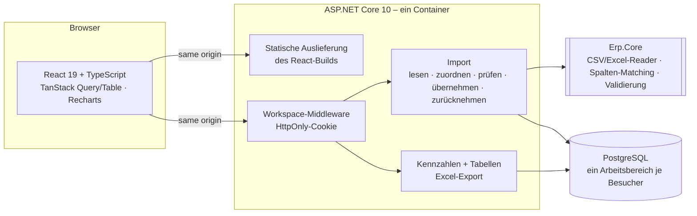

# ERP-Cockpit – ERP-Exporte einlesen, prüfen, auswerten

**Live-Demo: https://react.umut-aslan.dev** · kein Login nötig, jeder Besucher bekommt einen eigenen Arbeitsbereich

Kunden liefern ERP-Daten als CSV- oder Excel-Export; ausgewertet wird bisher per Hand in Excel. Das ERP-Cockpit
liest solche Exporte ein – auch „schmutzige“ aus alten Systemen –, prüft jede Zeile und macht daraus Kennzahlen:
Lagerwert, Lagerumschlag, Ladenhüter, Auftragsrückstand und Liefertreue, jeweils mit Drill-down und Excel-Export.

> Demo mit frei erfundenen Firmen und Daten (zwei Jahre simuliertes Ersatzteilgeschäft eines Maschinenbauers).

## Architektur



| Schicht | Aufgabe | Technik |
|---|---|---|
| **Frontend** | Dashboard, Tabellen mit Server-Paging/Sortierung, Import-Assistent, Filter in der URL | React 19, TypeScript, TanStack Query + Table, Recharts, React Router |
| **Kern** (`Erp.Core`) | Dateien lesen (Trennzeichen, UTF-8/Windows-1252, Zahlenformat je Spalte), Spalten automatisch zuordnen, Zeilen prüfen – ohne Datenbank, voll unit-getestet | C#, ClosedXML |
| **API** (`Erp.Api`) | Arbeitsbereiche, Import mit Undo-Log, Kennzahlen, Excel-Export, Beispieldateien | ASP.NET Core 10 Minimal APIs, EF Core 10 |
| **Daten** | eine Datenbank, jede Zeile gehört einem Arbeitsbereich; Löschen per Kaskade | PostgreSQL 17 |

Entscheidungen und Begründungen: [docs/adr](docs/adr).

## Was die Tests absichern

| Ebene | Anzahl | Beispiele |
|---|---|---|
| Kern (xUnit) | 31 | „1.234“ je nach Spalte als Tausend oder 1,234 · Windows-1252 mit Umlauten und Zeilenumbrüchen in Anführungszeichen · „Artikelnumer“ (Tippfehler) wird trotzdem zugeordnet · Abgänge bekommen ihr Vorzeichen aus der Bewegungsart |
| Demo-Daten (xUnit) | 4 | deterministisch · Bestand nie negativ · der unpünktlichste Lieferant ist wirklich L-170 · Fälligkeiten nach Kalenderwoche |
| API + PostgreSQL (xUnit) | 14 | Import mit Fehlerbericht und Rücknahme · Upsert stellt alte Preise wieder her · nur der letzte Import ist rücknehmbar · Arbeitsbereiche sind isoliert · Excel-Exporte sind echte .xlsx · Sicherheits-Header |
| Frontend (Vitest) | 5 | deutsche Zahlenformate · Tabellenansicht jedes Diagramms · Suche wartet 300 ms |
| End-to-End (Playwright) | 12 | kompletter Import im Browser · Drill-down vom Dashboard · Excel-Download · zwei Besucher sehen getrennte Daten · keine Fremd-Requests · kein Querscrollen auf dem Handy |

Die Backend-Tests laufen in der Zeitzone `Europe/Berlin` gegen eine echte PostgreSQL.

## Lokal starten

Voraussetzung: nur Docker.

```bash
cp .env.example .env     # Datenbank-Passwort setzen
./ops.sh test            # alle Tests, isoliert vom Live-System
./ops.sh deploy          # Tests, dann Start hinter Traefik
```

## Selbst ausprobieren

Im Bereich **Import** gibt es vier Beispieldateien aus typischen Quellen (Alt-ERP mit Semikolon und Windows-1252,
SAP-ähnliche Excel-Liste, Lieferantenportal mit englischen Zahlen, neue Kundenaufträge) – jeweils mit absichtlich
fehlerhaften Zeilen. „Ausprobieren“ lädt sie direkt in den Assistenten.

---
Ein Projekt von [Umut Aslan](https://umut-aslan.dev) · [Wie KI bei diesem Projekt eingesetzt wurde](docs/AI-WORKFLOW.md)
